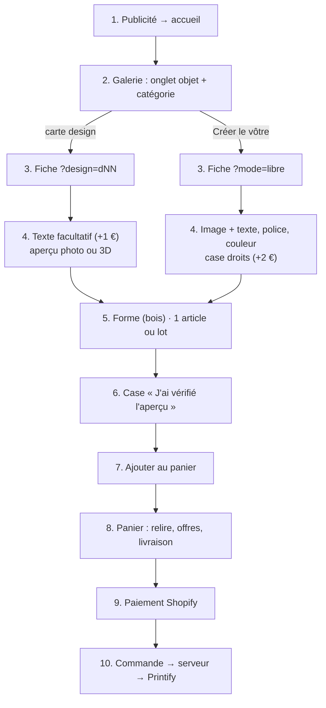

# FLOW - De la personnalisation à la commande

## Rôle
Le parcours d'une cliente, de la publicité au paiement : choisir un design (ou partir de son image),
personnaliser, vérifier, ajouter au panier, payer. La suite (fichier d'impression, Printify) est dans
[[FLOW - De la commande personnalisée à Printify]].

## Intention
- Le moins d'étapes possible : chaque lien de l'accueil ouvre une fiche déjà réglée.
- Aucune erreur d'impression : aperçu exact, rappel des accents, case de vérification obligatoire.
- Le prix est connu à chaque instant (options comprises) avant le panier.

## Diagramme

## Étapes
1. **Arrivée** (cliente) : publicité Meta → accueil ; le titre et la couverture reprennent le message de la pub.
2. **Choisir** (cliente) : onglet de l'objet, puis catégorie (Maman, Papa…, [[CMP - Catégories des designs]]) ; ou bouton « Créer le mien de A à Z ».
3. **Fiche** (thème) : `np.js` lit `?design=`, `?mode=`, `?texte=`, `?lot=` et règle la fiche ; le mug passe en 3D.
4. **Personnaliser** (cliente) : texte de 15 caractères au plus ; ou image JPG/PNG (contrôle de format, poids, définition), texte, police, couleur, case des droits. Le prix du bouton se met à jour (`refresh()`).
5. **Options** (cliente) : forme pour le bois ; « Lot de 3 » si elle veut le prix lot ([[FLOW - Lots et trio]]).
6. **Vérifier** (cliente) : rappel « nous imprimons exactement ce que vous voyez », case obligatoire ; sous le bouton, la règle de rétractation qui s'applique.
7. **Ajouter** (thème → Shopify) : formulaire `product` avec la variante et les propriétés ([[CMP - Panier]]) ; en lot, articles 1 et 2 ajoutés en arrière-plan.
8. **Panier** (cliente) : relit chaque ligne ; indications lot, trio et livraison offerte ; code trio posé tout seul ([[MOD - Panier et commande]]).
9. **Payer** (Shopify) : paiement Shopify Payments ; frais de port 4,90 € ou offerts dès 60 €.
10. **Fabriquer** (serveur, puis Printify) : [[FLOW - De la commande personnalisée à Printify]].

## Entrées et sorties
- Entrée : un clic sur une publicité ou une carte.
- Sortie : une commande Shopify dont chaque ligne porte variante + propriétés d'impression.

## Cas limites
- Elle oublie la case : le navigateur bloque l'envoi (champ `required`).
- Image refusée (format, > 15 Mo) : message rouge, pas d'ajout.
- Elle quitte au milieu d'un lot : les articles déjà ajoutés restent dans le panier.
- Variantes « Personnalisation » pas encore importées : prix affiché ≠ prix facturé ⚠️ ([[CMP - Produit]]).

## Notes liées
[[MOD - Catalogue et fiche produit]] · [[MOD - Panier et commande]] · [[CMP - Panier]] · [[FLOW - De la commande personnalisée à Printify]]
