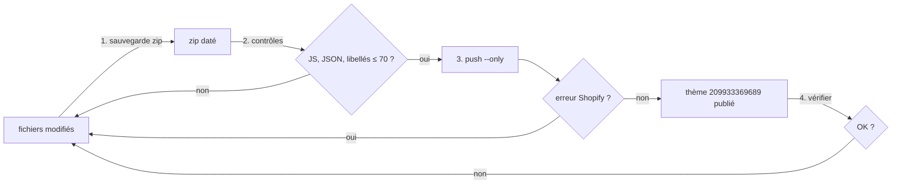

# FLOW - Déployer la maquette dans Shopify

## Rôle
Envoyer le thème local `~/Documents/nolaprint-theme` sur la boutique avec Shopify CLI. Le nom de la
note est historique : on ne déploie plus une maquette mais le thème NolaPrint lui-même.

## Intention
- Le thème est modifié en fichiers sur le Mac, puis poussé tel quel : rien n'est retapé dans l'admin.
- **Pousser seulement ce qui a changé** (`--only`) : un push complet remplace aussi les réglages faits dans l'éditeur Shopify (`config/settings_data.json`) et les textes des templates.
- Le push se fait depuis le Terminal du Mac : la session Claude n'a pas accès à Shopify (connexion refusée, constaté le 02/11).

## Diagramme


## Étapes
1. **Sauvegarder** (Claude ou Mateo) : zip des fichiers touchés à la racine, `_sauvegarde-avant-<sujet>-AAAA-MM-JJ.zip`.
2. **Contrôler** (Claude) : `node --check assets/np.js`, JSON des schémas valide, libellés de réglages ≤ 70 caractères.
3. **Pousser** (Mateo, Terminal) :
   ```
   cd ~/Documents/nolaprint-theme
   shopify theme push --store 04qh0j-2k.myshopify.com --theme 209933369689 --allow-live \
     --only assets/np.js --only sections/np-main-product.liquid   # un --only par fichier modifié
   ```
   `--allow-live` est obligatoire : le thème 209933369689 est le thème publié. La première fois, Shopify CLI demande de se connecter (code à valider dans le navigateur).
4. **Vérifier** (Mateo) : accueil, une fiche de chaque objet, panier, sur ordinateur et téléphone ; vider le cache si un ancien fichier s'affiche.

## Entrées et sorties
- Entrée : les dossiers de thème (`assets`, `blocks`, `config`, `layout`, `locales`, `sections`, `snippets`, `templates`).
- Sortie : le thème publié de 04qh0j-2k.myshopify.com mis à jour.
- Hors thème, non envoyés : `_imports-shopify/`, `_sauvegarde-*.zip`, `Claude outputs/`, `AGENTS.md`.

## Cas limites
- **Libellé de réglage trop long** (02/11, `np-offres` `show_trio`) : « pushed with errors », la section n'est pas mise à jour ; raccourcir et repousser ce seul fichier.
- **Erreur Liquid** (30/10) : balise mal fermée, Shopify refuse le fichier.
- **Push complet** : écrase les réglages de l'éditeur ; à éviter sauf refonte voulue.
- Chaque push est vu tout de suite par les visiteurs ; pour tester, pousser sur un thème non publié (sans `--allow-live`).

## Notes liées
[[MOD - Thème Shopify]] · [[FLOW - Importer les produits par CSV]] · [[OVR - Boutique NolaPrint]]
