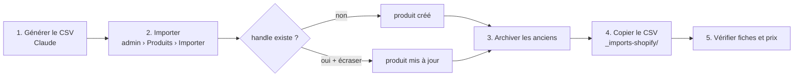

# FLOW - Importer les produits par CSV

## Rôle
Créer ou mettre à jour les produits de la boutique en important un CSV au format Shopify dans l'admin,
puis archiver ceux qui sortent du catalogue.

## Intention
- Le thème reconnaît les objets par leur **tag** (`np-mug`, `np-verre`, `np-bois`) et leurs **handles** ; le prix par les options **Forme** et **Personnalisation** : le CSV est la source de ces valeurs ([[CMP - Produit]]).
- **Archiver, pas supprimer** : un produit archivé garde son historique et peut revenir.
- Une copie de chaque CSV importé est rangée dans `~/Documents/nolaprint-theme/_imports-shopify/`.

## Diagramme

## Étapes
1. **Générer le CSV** (Claude) : colonnes Shopify standard ; une ligne par variante, seules les colonnes de variante remplies sur les lignes suivantes.
2. **Importer** (Mateo, navigateur) : admin Shopify › Produits › Importer ; cocher l'écrasement des produits de même handle pour une mise à jour.
3. **Archiver les anciens** (Mateo) : statut « Archivé ».
4. **Ranger une copie** dans `_imports-shopify/`, nommée par version.
5. **Vérifier** (Mateo) : fiche personnalisable (tag reconnu), 6 formes pour le bois, prix qui change avec le texte et « Votre image », panier facturé au même prix.

## Imports
| Date | Fichier | Contenu |
|---|---|---|
| 29/10 | `nolaprint-produits-29-10.csv` | les 5 anciens produits, archivés le 30/10 |
| 30/10 | `nolaprint-produits-v2.csv` | les 3 objets, sans option « Personnalisation » (24,90 / 27,90 / 19,90 €) |
| 30/10 | `nolaprint-bois-maj.csv` | description de la décoration en bois |
| à faire | `nolaprint-produits-v3-prix-decision-09.csv` | prix de la décision 09 : option « Personnalisation » (Illustration seule / + texte / Votre image), bois en Forme × Personnalisation ; 18,45-20,45 / 19,95-21,95 / 17,95-19,95 € ⚠️ import à confirmer |

Produits archivés : `mug-famille-illustree`, `affiche-famille-illustree`, `boule-de-noel-famille`, `duo-mamie-papi`, `lot-mug-affiche`.

## Entrées et sorties
- Entrée : un CSV au format d'import Shopify.
- Sortie : produits créés ou mis à jour dans 04qh0j-2k.myshopify.com.

## Cas limites
- **CSV v3 pas importé** : le thème affiche les bons prix (suppléments des réglages) mais le panier facture la variante de base ⚠️.
- **Prix barrés** : la colonne `Variant Compare At Price` est vide dans le v3 ; en écrasement, elle peut effacer les prix barrés actuels ⚠️.
- **Tag oublié** : fiche simple, sans designs ni aperçu.
- **Handle changé** : les liens de l'en-tête, de l'accueil et du trio ne trouvent plus le produit.
- **Nom de forme changé** : le premier mot doit rester une clé de `np-bois-shapes` (`coeur`, `sapin`, `etoile`, `cloche`, `chaussette`, `ovale`).
- **Nom de personnalisation changé** : le thème cherche « image » et « texte » dans le nom de la valeur.
- **Import sans écrasement** sur un handle existant : rien n'est mis à jour.

## Notes liées
[[CMP - Produit]] · [[MOD - Thème Shopify]] · [[FLOW - Déployer la maquette dans Shopify]]
