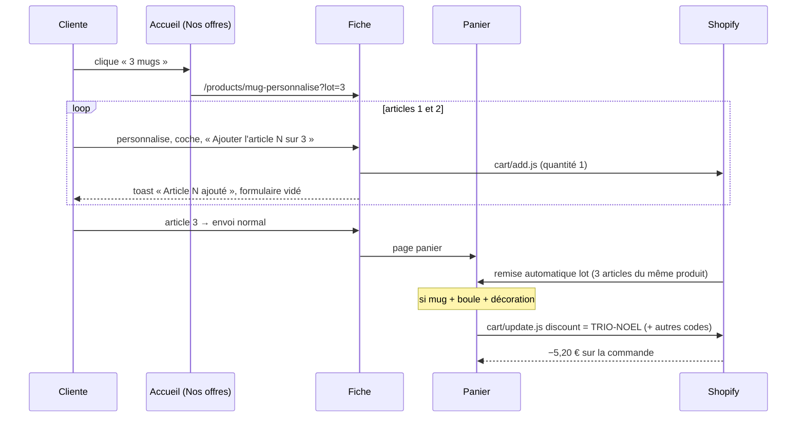

# FLOW - Lots et trio

## Rôle
Les deux offres de la boutique, de la carte de l'accueil jusqu'à la remise au paiement :
- **Lot de 3 du même objet** : 3 mugs, 3 boules ou 3 décorations, chacun avec son design et son texte, remisés par article.
- **Trio de Noël** : un mug + une boule + une décoration, −5,20 € sur la commande.

## Intention
- Gâter toute la famille en une commande : chaque article du lot garde sa propre personnalisation.
- Le thème montre l'offre ; **Shopify applique la remise** (remise automatique pour les lots, code pour le trio), pour que le prix payé soit sûr.
- ⚠️ Trio remisé à −5,20 € depuis le 02/11 (demande dans le chat), alors que la décision 12 le voulait « sans remise » : à acter par une décision.

## Diagramme

## Étapes
### Lot de 3
1. **Choisir** (cliente) : carte « 3 mugs / 3 boules / 3 décorations » de l'accueil (`?lot=3`), ou option « Lot de 3 » sur la fiche.
2. **Personnaliser 3 fois** (cliente) : la pastille « Article 1 sur 3 » avance ; chaque article a son design, sa forme et son texte ; la quantité est forcée à 1.
3. **Ajouter** (thème) : articles 1 et 2 par `cart/add.js` en arrière-plan, article 3 par l'envoi normal.
4. **Remiser** (Shopify) : remise automatique « Montant fixe sur des produits », quantité minimale 3 : −1,80 € par mug, −1,97 € par boule, −1,80 € par décoration (options payées au prix normal).
5. **Rappeler** (panier) : avec 1 ou 2 articles d'un même objet, « Encore N … pour le prix lot ».

### Trio de Noël
1. **Voir l'offre** (cliente) : carte « Le trio de Noël » (51,15 € barré 56,35 €), ou ligne « Un mug, une boule et une décoration » sous chaque fiche.
2. **Remplir le panier** (cliente) : un de chaque objet, dans n'importe quel ordre. Avec 2 objets sur 3, le panier dit lequel ajouter.
3. **Poser le code** (thème, `initTrio`) : ajoute `TRIO-NOEL` aux codes du panier, recharge si Shopify l'accepte ; le retire si un objet part.
4. **Remiser** (Shopify) : code « Montant fixe sur la commande » 5,20 €, combinable avec les remises produit.

## À créer dans Shopify
| Remise | Type | Réglage |
|---|---|---|
| Lot mugs | automatique, montant fixe sur des produits (chaque article) | produit mug, quantité minimale 3, 1,80 €, combinable avec les autres remises produit et le code trio |
| Lot boules | idem | produit boule, 1,97 € |
| Lot décorations | idem | produit décoration, 1,80 € |
| `TRIO-NOEL` | code, montant fixe sur la commande | 5,20 €, combinable avec les remises produit ; conseillé : minimum d'achat (ex. 50 €) |

Montants modifiables dans les réglages du thème (`np_lot_off_*`, `np_trio_off`, `np_trio_code`) : les changer aussi dans Shopify.

## Entrées et sorties
- Entrées : réglages du thème, remises Shopify, contenu du panier.
- Sorties : lignes de panier (1 par article), code de réduction sur le panier.

## Cas limites
- Remises pas créées dans Shopify : l'offre s'affiche mais rien n'est déduit ⚠️ à créer avant la mise en ligne.
- 6 mugs : la remise lot s'applique aux 6 (quantité minimale atteinte).
- Lot + trio : 3 mugs + 1 boule + 1 décoration → remise lot sur les mugs + trio, si les remises sont combinables.
- La cliente tape `TRIO-NOEL` sans les 3 objets : accepté par Shopify sauf minimum d'achat ⚠️.
- Code refusé par Shopify : `initTrio` ne recharge pas, une seule tentative par état (100 s).

## Notes liées
[[CMP - Produit]] · [[MOD - Panier et commande]] · [[MOD - Accueil]] · [[12 - Lots de 3 à environ moins 10 %, lot un de chaque sans remise]]
