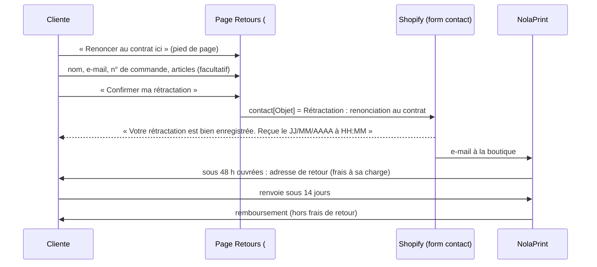

# FLOW - Rétractation en ligne

## Rôle
Le parcours « Renoncer au contrat ici » : du lien du pied de page jusqu'à la confirmation, puis le
traitement par nous. Fonction obligatoire depuis le 19/06/2026 (ordonnance n° 2026-2).

## Intention
- **Accessible partout** : lien simple « Renoncer au contrat ici » dans le pied de page, vers `/pages/retractation#renoncer`.
- **E-mail d'abord, formulaire légal en bas** : la page Retours explique les cas (casse, 14 jours sans texte, articles personnalisés exclus) avant le formulaire.
- **Prévenir sans bloquer** : la demande part même pour un article personnalisé ; on répond article par article.
- **Un humain décide** du remboursement ([[03 - Approbation unitaire au lancement, paliers d'autonomie, actions toujours bloquées]]).

## Diagramme

## Étapes
1. **Ouvrir** (cliente) : lien du pied de page (`np-footer.liquid` l.28) → section `#renoncer` de la page Retours.
2. **Remplir** (cliente) : prénom et nom, e-mail de la commande, numéro de commande ; articles concernés facultatif (vide = toute la commande).
3. **Confirmer** (cliente) : bouton « Confirmer ma rétractation ».
4. **Accuser réception** (Shopify) : message à l'écran avec date et heure ; ⚠️ l'accusé par e-mail automatique n'est pas encore branché (obligatoire).
5. **Répondre** (Mateo ou Antoine, sous 48 h ouvrées) : vérifier l'éligibilité (article sans texte ni image), envoyer l'adresse de retour.
6. **Recevoir et rembourser** (humain) : retour chez nous ([[11 - Texte facultatif à 1 €, frais de retour à la charge du client, retours chez Sylvain]]), remboursement sous 14 jours ; l'article sans défaut rejoint le stock maison ([[TODO - Stock maison, bloquer Printify quand le produit est déjà chez nous]]).

## Entrées et sorties
- Entrée : la demande de la cliente.
- Sortie : un e-mail de contact Shopify avec l'objet « Rétractation : renonciation au contrat » ; le remboursement est fait à la main dans Shopify.

## Cas limites
- Article personnalisé (texte ou image) : exclu (art. L221-28 3°) ; on le dit dans la réponse, la casse reste couverte.
- Numéro de commande faux : rien ne le contrôle dans le formulaire, on le vérifie à la main.
- Le formulaire passe par le service de contact Shopify : filtre anti-spam possible ⚠️ à tester.

## Notes liées
[[MOD - Pages légales et rétractation]] · [[SYN - Juridique]] · [[TODO - Choisir les apps de rétractation et de consentement]]
